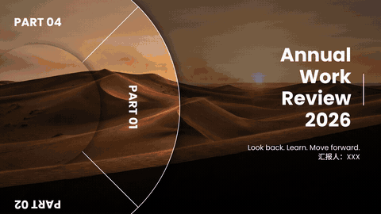

# 动态 PPT 模板 · dynamic-ppt-skills

一套给 AI 用的动态 PPT 技能（skill）。把它装进你的 AI 助手（例如 Claude Code、Codex、Cursor），然后直接用一句话说你要什么：

> 用镂空开场帮我做一页职业规划大赛的开场，大字写 MY FUTURE，用这张图。

AI 会自己选模板、写文案、换上你的图，把做好的 .pptx 交给你，用 PowerPoint 或 WPS 打开就能放映。网上很火、平时很难手动做出来的动态效果，说一句话就有。

## 模板一览

| 模板 | 效果 | 适合 |
|---|---|---|
| [镂空开场 hollow-opening](templates/hollow-opening/) |  | 职业规划大赛、演讲、年终汇报的开场页 |
| [圆环连招 ring-combo](templates/ring-combo/) |  | 封面 + 目录 + 4 个章节一整套，职业规划大赛、答辩、述职 |
| [旋转转盘 rotary-dial](templates/rotary-dial/) |  | 分 4 部分讲、每页换一张图，年终汇报、项目复盘、作品集 |
| [多图轮播 photo-carousel](templates/photo-carousel/) |  | 照片很多想一页放完：年会、年终总结、团建和活动风采 |
| [数字过渡页 number-transition](templates/number-transition/) |  | 「第一部分、第二部分」的章节页，职业规划大赛、答辩、述职 |
| [唱片机结束页 record-ending](templates/record-ending/) |  | 最后一页的感谢语：演讲、分享会、课程、职业规划大赛 |

## 怎么用

**交给 AI（推荐）：** 把本仓库下载到你的项目里，或者直接把仓库地址发给 AI，让它按 [SKILL.md](SKILL.md) 来做。之后只要说「用 XX 模板做一个 XX」就行，文字、图片、字体都可以在对话里提。

**自己运行（可选）：** 每个模板也是一个普通的 Python 程序，不用 AI 也能跑。需要 Python 3.9 及以上：

```bash
pip install -r requirements.txt
python templates/hollow-opening/generate.py --word "DREAM BIG" --title "心向远方 步履不停" --image 我的图.jpg --out 开场.pptx
```

每个模板能换哪些内容，看它文件夹里的 README。

## 播放要求

- 建议用 PowerPoint 2019 及以上、Microsoft 365 或 WPS 放映，每个模板的具体要求写在它自己的 README 里。
- 文字都会转成形状，对方电脑没装字体也不会变样。

## 字体

[fonts/](fonts/) 里只放免费可商用、允许分发的字体（SIL OFL 授权），所有模板共用。也可以传入你自己的字体文件。
