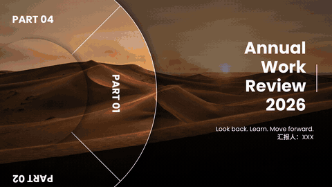

# 旋转转盘 · rotary-dial



4 页的转盘式 PPT，页与页之间用「平滑」切换：

- 左边是半个双层圆盘，外圈有十字分隔线和 4 个标签（PART 01～04），带投影浮在画面上，盘面里透出当页的底图。
- 每翻一页，圆盘逆时针转 90°，下一个标签转到正右边；底图同时换成下一张，右边的文字上下滚动切换。
- 4 页文字排法各不相同：第 1 页封面大标题，第 2 页章节标题，第 3 页要点列表，第 4 页展望收尾。

适合年终汇报、项目复盘、述职、作品集这种分 4 部分讲、每部分想换一个画面的 PPT。

## 让 AI 做

直接对 AI 说，例如：

> 用旋转转盘做一份年终汇报，标题 Annual Work Review 2026，汇报人写张三，第三页列三条成绩，用这 4 张图。

没说的内容 AI 会帮你补上，做完把 .pptx 和一个网页预览交给你。用 PowerPoint 或 WPS 打开，按 F5 放映，点一下翻一页。

## 自己运行

```bash
pip install -r ../../requirements.txt
python generate.py --title "Annual\nWork\nReview\n2026" --subtitle "Look back. Learn. Move forward." --reporter "汇报人：XXX" \
  --page "Chapter One\nThe Year in Review|12 projects. 100% on time." \
  --page "Key Results|Satisfaction up to 95%\n3 new business lines\n6 new team leads" \
  --page "Looking Ahead|Go deeper. Grow stronger." \
  --images 1.jpg 2.jpg 3.jpg 4.jpg --out 年终汇报.pptx --preview 预览.html
```

## 能换什么

下面这些都可以在对话里直接跟 AI 说，AI 会换成对应的参数。

| 参数 | 作用 | 默认值 |
|---|---|---|
| `--images` | 4 张底图，按页的顺序，一页一张。横图最佳（16:9），建议 2K 以上；少于 4 张会循环使用 | 沙丘、城市、海崖、星空 4 张示例图 |
| `--title` | 第 1 页大标题，右对齐，用 `\n` 换行，每行 1～2 个词最好看 | `Annual\nWork\nReview\n2026` |
| `--subtitle` | 第 1 页标题下面的一句话。传 `""` 不显示 | `Look back. Learn. Move forward.` |
| `--reporter` | 第 1 页署名。传 `""` 不显示 | `汇报人：XXX` |
| `--page` | 第 2、3、4 页的文字，**按顺序传 3 次**。格式 `标题\|正文`，用 `\n` 换行。第 3 页的正文每行是一条要点，3 条最合适；第 2、4 页正文一句话 | 见上面的命令 |
| `--label` | 转盘标签的前缀，显示成「PART 01」…。传 `""` 只显示数字 | `PART` |
| `--en-font` / `--en-bold-font` | 英文正文 / 英文标题和标签字体 | `fonts/Poppins-Regular.ttf` / `fonts/Poppins-Bold.ttf` |
| `--cn-font` / `--cn-bold-font` | 中文正文 / 中文标题字体 | `fonts/NotoSansSC-Medium.ttf` / `fonts/NotoSansSC-Black.ttf` |
| `--duration` | 平滑切换时长，单位毫秒 | `1400` |
| `--out` | 输出的 PPT 文件名 | `旋转转盘.pptx` |
| `--preview` | 同时输出一个网页预览 | 不输出 |

## 搭配建议

| 场景 | 第 1 页标题 | 第 2～4 页 |
|---|---|---|
| 年终汇报 | Annual Work Review 2026 | 年度回顾 · 核心成绩 · 明年计划 |
| 项目复盘 | Project Recap | 背景 · 成果三条 · 下一步 |
| 个人作品集 | My Portfolio | 关于我 · 代表作三件 · 联系方式 |

4 张底图选色调不同、但都偏暗或有大片天空的横图，换页时颜色变化最明显，白字也看得清。

## 说明

- 所有文字都已转成形状，换一台没装这些字体的电脑打开，效果也一样；但打开后文字不能再直接改，要改就重新运行一次。
- 转盘里透出的是当页的幻灯片背景，所以底图要通过 `--images` 换。
- 平滑切换需要 PowerPoint 2019 及以上、Microsoft 365 或 WPS。旧版 PowerPoint 只能看到淡入淡出。
- 网页预览只用来看效果，正式放映以 PPT 为准。
